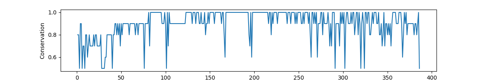
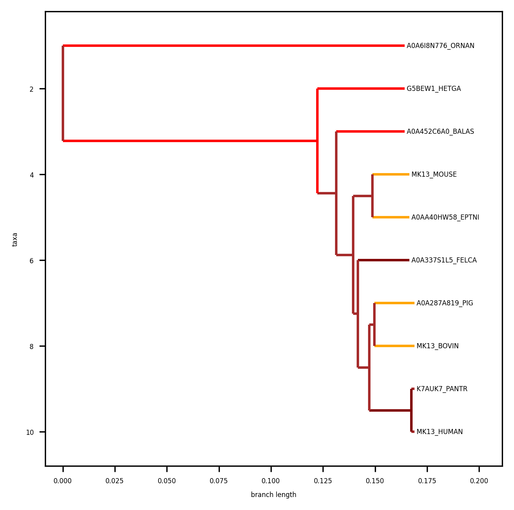

# Portfolio Projects

All three portfolio projects **must be completed as part of your LIFE733 portfolio, in addition to the BioBoost knowledge checks**. Instructions for the BioBoost knowledge checks will be introduced separately.

The video below gives an overview of the portfolio projects and how to approach them.

<iframe title="Portfolio Projects overview" width="560" height="315" src="https://www.youtube.com/embed/M4z868qJyF4?si=OA4bfls0XCTZx2VI" loading="lazy" allow="accelerometer; autoplay; clipboard-write; encrypted-media; gyroscope; picture-in-picture; web-share" referrerpolicy="strict-origin-when-cross-origin" allowfullscreen></iframe>

:::{important}
:class: mt-8

## What you must submit to Canvas

Before the deadline stated on Canvas — **before Christmas** — submit **one ZIP file** to the Canvas portfolio submission. The ZIP must contain your complete `LIFE733` folder, including:

- your Python solutions for the weekly problems in every `week-*` folder;
- all three portfolio projects, including your code, generated inputs, README files, results, and `gai_log.txt` files; and
- any required test transcript or other evidence produced by a project.

Name the final file clearly, for example `LIFE733_123456789_portfolio.zip`. Do not submit separate weekly files or separate project ZIP files to Canvas. Create one ZIP of the complete `LIFE733` folder and submit it before the Canvas deadline.
:::

For Project 1, use the small practice examples written in this chapter to develop and test your code. For Project 2, download and use the shared practice files linked in its section. For Project 3, use the supplied human and mammal proteomes and test the pipeline with the three required proteins. Once your code works with the practice material or required test cases, complete the individual run required by that project. Completing only practice examples does not complete a portfolio project.

Your individual files are personal to your student ID. Entering the same ID again creates the same dataset; different IDs create different DNA data with the same task structure. The generator runs in your browser without sending your ID to a server. Keep the downloaded README with your inputs because it records the dataset version you used.

## Required folder and submission structure

Keep every weekly problem and portfolio project inside one `LIFE733` folder. The final ZIP submitted to Canvas must contain this folder itself, not a loose collection of files.

```text
LIFE733/
├── week-1/                            ← weekly problem Python files and any data
├── week-2/                            ← weekly problem Python files and any data
├── week-3/
├── week-4/
├── week-5/
├── week-6/
├── week-8/
├── week-9/
├── week-10/
├── week-11/
├── week-12/
└── portfolio/
    ├── project-1/
    │   ├── README.txt
    │   ├── gai_log.txt
    │   ├── test_project1.py
    │   ├── project1_test_transcript.txt
    │   ├── part-a-dna/
    │   │   ├── part_a.py
    │   │   ├── project1_<student-id>_part-a_fragments.txt
    │   │   └── part_a_results.txt
    │   ├── part-b-counts/
    │   │   ├── part_b.py
    │   │   ├── project1_<student-id>_part-b_counts.txt
    │   │   └── part_b_results.txt
    │   ├── part-c-replicates/
    │   │   ├── part_c.py
    │   │   ├── project1_<student-id>_part-c_replicates.tsv
    │   │   └── part_c_results.txt
    │   └── part-d-sequences/
    │       ├── part_d.py
    │       ├── project1_<student-id>_part-d_sequences.fasta
    │       └── part_d_results.txt
    ├── project-2/
    │   ├── main.py
    │   ├── fasta_tools.py
    │   ├── gai_log.txt
    │   ├── practice/
    │   ├── input/                    ← generated FASTA, codon table, and README
    │   └── output/
    │       ├── orfs.fasta
    │       ├── proteins.fasta
    │       ├── motif_hits.fasta
    │       └── summary.tsv
    └── project-3/
        ├── project3_<student-id>.py
        ├── project3_testing_report.pdf
        ├── gai_log.txt
        ├── A3_starter.py
        ├── select_protein.py
        ├── UP000005640_9606.fasta
        └── 10_uniprot_mammals.fasta

LIFE733_<student-id>_portfolio.zip     ← ZIP this complete LIFE733 folder for Canvas
```

Open one part folder in VS Code at a time and check the terminal location before running its script. Use the practice snippets shown in this chapter for initial checks, then run the finished script against the generated `project1_<student-id>_...` filename beside it. Each script must print its result and save it in that same part folder with the exact filename shown above. Do not use a generic `results.txt`, move the file to another folder, or rename it: `test_project1.py` checks these exact paths. The angle-bracketed `<student-id>` is a placeholder: use the nine digits in the downloaded filename, without the angle brackets.

Attempt each part yourself before checking the expected practice output shown below. Follow the course's portfolio submission and AI-use instructions. This page does not replace those instructions.

## Project 1: DNA sequences and cell counts

This project combines string transformations, numerical summaries, decisions, and validation. Each part below includes a small practice snippet and an exact expected output.

### Generate your Project 1 dataset

<iframe title="Generate a Project 1 portfolio dataset" src="../portfolio-generator/index.html?project=1" width="100%" height="650" loading="lazy"></iframe>

Download the generated ZIP, which includes the README and all four part datasets. Each data filename identifies Project 1 and its part: Part A contains two DNA strings, Part B one integer per line, Part C a replicate table, and Part D multiple named FASTA records. Use the practice snippets below to check your script first, then use your extracted generated files and produce the same fields and formatting with your own values.

The generator now provides one ZIP file containing the complete Project 1 folder structure. Download it, create a new empty folder such as `LIFE733/portfolio/project-1`, and extract the ZIP into that folder. Do not open individual files from the browser and do not rearrange the extracted folders.

In VS Code, choose **File → Open Folder**, select the extracted `project-1` folder, and open **Terminal → New Terminal**. Check the location with `pwd` and list the contents with `ls`. Open one of the `part-a-dna`, `part-b-counts`, `part-c-replicates`, or `part-d-sequences` folders when you work on that part. Each folder contains its recommended script and generated input. Keep the generated input unchanged. Follow the save instruction at the top of each script, then run `test_project1.py` from the `project-1` folder.

If the embedded form is too small, [open the Project 1 generator in a separate tab](../portfolio-generator/index.html?project=1).

### Part A: DNA string transformations

Use these example fragments:

```python
fragment_1 = "actgtgtcag"  # First shared practice fragment.
fragment_2 = "tcagttttgg"  # Second shared practice fragment.
```

Join the fragments and convert the result to uppercase. Print its length. Then calculate the reverse complement, transcribe DNA to RNA, append seven `A` characters, and print the final RNA length.

**Expected practice output:** the combined DNA is `ACTGTGTCAGTCAGTTTTGG`, with length `20`. Its reverse complement is `CCAAAACTGACTGACACAGT`. The final RNA is `ACUGUGUCAGUCAGUUUUGGAAAAAAA`, with length `27` after adding seven `A` characters.

Your Part A script must print exactly this for the practice snippet (including labels and decimal-free length):

```text
DNA: ACTGTGTCAGTCAGTTTTGG
DNA length: 20
Reverse complement: CCAAAACTGACTGACACAGT
RNA: ACUGUGUCAGUCAGUUUUGGAAAAAAA
RNA length: 27
```

When you switch to your generated Part A file, keep this exact five-line format but replace the values with results from your own two fragments.

For your individual run, read the two lines from the downloaded Part A file. Strip surrounding whitespace and perform the same operations on those values. Both individual fragments have 24 bases, so their combined length is 48 and the RNA length after adding the tail is 55. The sequence itself depends on your ID.

### Part B: replicate statistics

Use the synthetic cell counts `[18, 21, 19, 22, 20]`. Calculate and print the total, mean, population variance, population standard deviation, median, and range. Format reported statistics to one decimal place.

For population variance, calculate the mean squared difference from the mean. The population standard deviation is the square root of that variance. The median is the middle value after sorting.

**Practice check:** total `100.0`, mean `20.0`, population variance `2.0`, population standard deviation `1.4`, median `20.0`, and range `4.0`.

Use this practice snippet before reading your generated Part B file:

```python
counts = [18, 21, 19, 22, 20]
```

Your script must print exactly:

```text
Total: 100.0
Mean: 20.0
Population variance: 2.0
Population standard deviation: 1.4
Median: 20.0
Range: 4.0
```

For your generated counts, keep these six labels and one decimal place exactly. Do not print a hard-coded `100.0` or assume that there are five values.

For your individual run, load the integers from the counts file rather than embedding the practice list in your code. There are seven counts. Use the list length in your calculations instead of assuming five.

### Part C: classify replicate measurements

Classify these protein concentration replicates, measured in mg/L: `[104, 112, 108]`. First reject values outside 0–2000. Then classify all values below 10 as a failed assay, all equal values as uniform, exactly two equal values as duplicates, and otherwise compare each value's absolute deviation from the mean with 20% of the mean. If every deviation is at most 20%, classify the sample as consistent. Otherwise classify it as containing an outlier.

Write a function that accepts a list and returns a classification string. Test at least one case for every classification and explain which branch should take precedence when conditions overlap.

**Expected practice output:** the sample `[104, 112, 108]` is `consistent`. For your individual run, skip the header row in the downloaded Part C file, convert its three measurements to numbers, and apply your function to every sample. Print or save each sample identifier with its classification. Do not apply one classification to the whole file.

For the practice sample, your classification function must produce:

```text
sample_practice: Consistent assay
```

For the generated Part C table, print one line per sample in the form `sample_name: classification`, preserving the six classification names `Invalid`, `Failed assay`, `Uniform replicates`, `Duplicate replicates`, `Consistent assay`, and `Outlier replicate`.

### Part D: validate sequences

Analyse these synthetic FASTA records:

```text
>sample_1
ATGCCGTAA
>sample_2
ATNXGTA
>sample_3
GCGCGC
```

Parse complete records and join wrapped sequence lines before validation. Keep each header so you can identify its result. A sequence is valid only if it contains A, C, G, or T and its length is divisible by three. For valid records, calculate GC percentage and classify it as AT-rich (<40%), balanced (40–60% inclusive), or GC-rich (>60%). Report counts of valid and invalid records.

**Expected practice output:** two valid records and one invalid record. `sample_1` has GC `55.56%` (balanced). `sample_3` has GC `100.00%` (GC-rich). Validate a nonempty complete sequence, not each wrapped line independently.

For the practice FASTA, your script must print exactly:

```text
sample_1: valid, length=9, GC=55.56%, category=Balanced
sample_2: invalid
sample_3: valid, length=6, GC=100.00%, category=GC-rich
Summary: 2 valid, 1 invalid
```

When you use your generated Part D file, keep this line structure, two decimal places, and final summary, replacing the identifiers and values with your own results.

Run the same analysis on your individual FASTA file. Save each record's identifier, validity, and, where valid, length, GC percentage, and GC category. Report the totals alongside your other Project 1 results.

## Project 2: A small FASTA analysis pipeline

Set up a new folder and keep Project 2's scripts, inputs, and outputs separate from Project 1:

```text
portfolio/
└── project-2/
    ├── main.py          ← Driver script
    ├── fasta_tools.py   ← Reusable functions
    ├── test_project2.py ← Checks the required individual-run output files
    ├── gai_log.txt      ← Record meaningful GAI use
    ├── practice/        ← Included shared practice FASTA and codon table
    ├── input/           ← Generated FASTA, codon table, and README.txt
    ├── output/          ← Results from your individual run
    └── project2_test_transcript.txt  ← created by test_project2.py
```

Open `project-2` in VS Code before starting this project. Do not reuse the Project 1 scripts or output folder. Test the practice files first, then generate and run against the Project 2 dataset.

This project joins file handling, dictionaries, functions, loops, validation, and regular expressions. The generated Project 2 ZIP includes the shared practice FASTA and codon table in its `practice` folder. The practice FASTA contains:

```text
>gene_alpha synthetic example
ATGAAACCCGGGTAA
>gene_beta synthetic example
ATGCCCTAG
>gene_gamma contains invalid symbol
ATGNAA
```

### Generate your Project 2 dataset

<iframe title="Generate a Project 2 portfolio dataset" src="../portfolio-generator/project-2.html" width="100%" height="590" loading="lazy"></iframe>

Download the complete Project 2 ZIP and extract it into `LIFE733/portfolio/`. It includes `main.py`, `fasta_tools.py`, `test_project2.py`, `gai_log.txt`, the practice files, and your generated input files with `README.txt`. Keep the generated files in `input/` unchanged. Run `python test_project2.py` from the `project-2` folder after your program has created its output files. [Open the Project 2 generator in a separate tab](../portfolio-generator/project-2.html) if needed.

The individual FASTA includes wrapped lines, invalid records, multiple candidate starts, and proteins with and without motif matches. Use the supplied codon table for both practice and individual data: the six-codon demonstration table in the solutions is too small for the individual sequences. The downloaded table covers all codons used in the valid supplied sequences. It is a teaching subset, not the complete genetic code.

### Stage 1: parse and clean records

Write `read_fasta(filename)` to return a dictionary mapping each full header to its uppercase sequence. Handle wrapped sequence lines. Report the number of records, valid records, invalid records, and mean length of valid sequences. For this project, valid DNA is nonempty and contains only A, C, G, and T. Reject missing or repeated headers rather than overwriting records. If there are no valid records, report the mean length as unavailable instead of dividing by zero.

**Practice check:** three records, two valid, one invalid. Mean valid length `12.0`. Apply the same checks to every individual record.

### Stage 2: find candidate ORFs

Write `find_orfs(sequence)` to scan all three reading frames. Treat an ORF as any start codon `ATG` followed in the same frame by its first downstream stop codon (`TAA`, `TAG`, or `TGA`). Scan the supplied forward strand only. Return the nucleotide strings from start through stop, inclusive. Each start gets its own candidate, including nested starts. Do not return a start without an in-frame stop. Test with `ATGAAACCCGGGTAA` and `ATGCCCTAG`.

Save the candidate ORFs with their source record identifiers. Use a separate numbered identifier for each candidate. Finding ORFs is a separate stage from the full-record translation below.

### Stage 3: translate valid DNA

Read the downloaded tab-separated codon table into a dictionary, skipping its header. Translate each valid full FASTA record from its first base, in triplets, and represent stop codons with `*`. For this project, retain stop symbols and continue to the end of the record. This differs from Week 5's stop-at-first-stop exercise. Skip invalid records and report their identifiers. Reject incomplete trailing triplets and missing codon mappings with a clear message instead of silently dropping bases or inventing a translation.

Write translated records to `output/proteins.fasta`, keeping a corresponding identifier for each protein. All valid records generated for this project have complete triplets and use the supplied mappings.

**Practice check:** the two protein strings are `MKPG*` and `MP*`.

### Stage 4: search protein motifs

Use the regular expression `N[^P][ST]` to find candidate N-linked glycosylation-like motifs in protein sequences. A pattern match alone does not establish that a protein is glycosylated. Do not match across stop symbols: search each segment obtained with `protein.split("*")` separately. Report protein length, number of stop symbols, and number of non-overlapping motif matches. Try a small protein string with one known match and one near-match.

The practice proteins have zero hits, so also test `NAT` (one hit), `NPS` (no hit), and `N*S` (no hit across a stop). Save matching protein records to `output/motif_hits.fasta`. Create an empty file if no proteins match.

### Stage 5: organise your program

Move reusable functions into `sequtils.py` or `fasta_tools.py`, then import them from a short driver script. Write `output/summary.tsv` with this exact tab-separated header: `record_identifier`, `dna_length`, `validity`, `orf_count`, `protein_length`, `stop_symbol_count`, and `motif_hit_count`. Write one row per input record in input order. Use lowercase `valid` or `invalid`; for an invalid record, use `NA` in every analysis column after validity. Include brief tests for an empty FASTA file, a wrapped sequence, and an invalid base.

### Expected practice outputs

When you run the shared practice FASTA, your four output files should contain the following. These examples use `source_identifier_orf_number` names for candidate ORFs; keep the same naming pattern for your individual run.

`output/orfs.fasta`

```text
>gene_alpha_orf_1
ATGAAACCCGGGTAA
>gene_beta_orf_1
ATGCCCTAG
```

`output/proteins.fasta`

```text
>gene_alpha
MKPG*
>gene_beta
MP*
```

`output/motif_hits.fasta` is empty because neither practice protein contains a motif match.

`output/summary.tsv`

```text
record_identifier	dna_length	validity	orf_count	protein_length	stop_symbol_count	motif_hit_count
gene_alpha	15	valid	1	5	1	0
gene_beta	9	valid	1	3	1	0
gene_gamma	6	invalid	NA	NA	NA	NA
```

Once the practice checks pass, run all stages against your individual FASTA and codon table. Save the individual-run outputs with these exact paths: `output/orfs.fasta`, `output/proteins.fasta`, `output/motif_hits.fasta`, and `output/summary.tsv`. Keep those results together with your code, dataset README, and `gai_log.txt` for your portfolio.

## Project 3: A Biopython orthologue pipeline

In this project, build a small pipeline that retrieves a protein from the
human proteome, searches a database of 10 mammal proteomes with BLAST to find
likely orthologues, aligns the results with MUSCLE, creates phylogenetic trees,
and produces plots. It builds on Week 8 (BLAST and `SeqIO`) and Week 9
(MUSCLE, `AlignIO`, conservation, and trees). Make sure those examples work on
your computer before you start.

:::{important}
## How you use generative AI is part of the mark

Your `gai_log.txt` is assessed. Keep a clear record of every meaningful GAI
prompt and what you did with the response. Responsible uses include debugging,
explaining a concept, and reviewing code you wrote yourself. Giving this brief
to an AI coding agent or chatbot and submitting its generated pipeline will
score very poorly. Read [GAI use in Project 3](#project-3-gai) before starting.
:::

### What you must submit for Project 3

Keep all Project 3 work in `LIFE733/portfolio/project-3/`. Your submission
must include:

1. One complete pipeline named `project3_<student-id>.py`.
2. A testing report in PDF or DOCX format, called `project3_testing_report`,
   with the output images and plots for these three inputs:
   - `PM34_HUMAN`;
   - the protein assigned by `select_protein.py`; and
   - one human protein chosen at random.
3. `gai_log.txt`, recording GAI use as described below.

The two large FASTA files and the `UP_mammals` BLAST database files are only
needed to run the pipeline. Delete them before creating the final portfolio
ZIP so it remains small.

### Set up Project 3

Download these Canvas files into `project-3`:

- [10 mammalian proteomes](https://canvas.liverpool.ac.uk/courses/95131/files/14451743?module_item_id=2725161), saved as `10_uniprot_mammals.fasta`;
- [human proteome](https://canvas.liverpool.ac.uk/courses/95131/files/14451769?module_item_id=2725162), saved as `UP000005640_9606.fasta`;
- [the required starter code](https://canvas.liverpool.ac.uk/courses/95131/files/14451748?module_item_id=2725159), saved as `A3_starter.py`; and
- [the protein-selection script](https://canvas.liverpool.ac.uk/courses/95131/files/14451731?module_item_id=2725160), saved as `select_protein.py`.

Use the Canvas copy of `UP000005640_9606.fasta`, not the Week 8 copy:
`select_protein.py` assigns a protein by its position in that specific file.
Find your assigned protein from the `project-3` folder, using your nine-digit
student ID:

```bash
python select_protein.py [YOUR_STUDENT_ID]
```

Before running your pipeline, create the BLAST database once in the terminal,
not from Python:

```bash
makeblastdb -in 10_uniprot_mammals.fasta -dbtype prot -out UP_mammals
```

All students must start their program with the block supplied in
`A3_starter.py`. You may add imports above it.

```python
from Bio import SeqIO
import random
import os
from Bio import AlignIO
from Bio.Phylo.TreeConstruction import *
from Bio import Phylo
import matplotlib.pyplot as plt
import matplotlib

def get_arguments_a3():
   import argparse
   parser = argparse.ArgumentParser(description="Assignment 3")
   parser.add_argument("-protname", type=str, help="Protein name", required=True)
   parser.add_argument("-blastcom", type=str, help="Blast executable", required=True)
   parser.add_argument("-musclecom", type=str, help="muscle executable", required=True)
   parser.add_argument("-fastafile", type=str, help="Source fasta file", required=True)
   parser.add_argument("-databasefasta", type=str, help="Target database file", required=True)
   args = parser.parse_args()
   return [arg for arg in vars(args).values()]


if __name__ == "__main__":
   input_args = get_arguments_a3()
   protein_name = input_args[0]
   blast_exe = input_args[1]
   muscle_exe = input_args[2]
   human_fasta = input_args[3]
   database_fasta = input_args[4]

print("Pipeline running with protein name", protein_name)
print("Running with BLAST as", blast_exe)
print("Running with muscle as", muscle_exe)
print("Source fasta:", human_fasta)
print("Database to search against:", database_fasta)

### Put your code to execute below
```

Run the program with named arguments. Save your run commands in a text file so
you can reuse them as a record of each test:

```bash
python project3_<student-id>.py -protname PM34_HUMAN -blastcom blastp -musclecom muscle.exe -fastafile UP000005640_9606.fasta -databasefasta 10_uniprot_mammals.fasta
```

`-protname` is a protein identifier such as `PM34_HUMAN`; `-blastcom` and
`-musclecom` are the exact commands or executable paths that work on your
computer; `-fastafile` is the human FASTA file; and `-databasefasta` is the
mammal FASTA file. The protein name is the third part of each UniProt
identifier: `PM34_HUMAN` in `>sp|O43808|PM34_HUMAN ...`.

### Part 1: BLAST

Use `SeqIO` to find the requested human record in
`UP000005640_9606.fasta`; you will need to split its record identifier. Define
`RND` as a random integer from 1 to 10,000, then make these temporary names:

- `blast_input = f"temp_{RND}_blast_input.txt"`
- `blast_output = f"temp_{RND}_blast_output.tsv"`

Write the human record to `blast_input`, then run BLAST with this exact command:

```python
command = blast_exe + " -db UP_mammals -query " + blast_input + " -out " + blast_output + " -outfmt 6"
```

Read the tab-separated output: columns 1 and 2 identify the input and hit,
column 11 is the E-value, and column 12 is the BLAST score. Write a new FASTA
file containing hits with E-values below `1E-5`, retaining only the best hit
(highest score) per target species. BLAST results are already highest-score
first. A dictionary mapping IDs to `SeqRecord` objects and a set or dictionary
of species are useful here. Write the selected records to
`temp_{RND}_msa_input.fasta`, then delete the temporary BLAST files once the
handles are closed.

### Part 2: Multiple sequence alignment

Using the same random value, set `msa_input` to
`temp_{RND}_msa_input.fasta` and `msa_output` to
`temp_{RND}_msa_output.fasta`. Run MUSCLE with:

```python
muscle_exe + " -align " + msa_input + " -output " + msa_output
```

Read the alignment using `AlignIO`, plot the conservation of the most common
amino acid across the alignment, and save `{RND}_consensus_plot.png`. Test
with several random examples for the report.



### Part 3: Phylogenetics

Using the Part 2 alignment and a `blosum62` distance calculator, create NJ and
UPGMA trees. Save them as `temp_{RND}_phylo_NJ.png` and
`temp_{RND}_phylo_UPGMA.png`. Label leaves with protein names and colour each
clade by `branch_length`: brown below 0.01, orange below 0.02, maroon below
0.03, and red otherwise.



### Part 4: Advanced options

After all required stages work, add some creative, useful improvements. For
example, add a BLAST-score histogram, annotate the conservation plot, accept
multiple comma-separated protein names while preserving single-name operation,
or create a multipage PDF of plots. You do not need every option, but this
section rewards thoughtful extension and testing.

(project-3-gai)=
### GAI use in Project 3

The rules on [Using Generative AI](gai.md) apply. Use the University-sanctioned
platform. Record every meaningful interaction in `gai_log.txt`, including the
date and tool, project part, your attempt before asking, exact prompt, a brief
response summary, what you used or rejected and why, and how you checked it.
Record unhelpful interactions too.

Appropriate uses include asking for an explanation of BLAST output columns,
requesting small test cases for a species-extraction function, debugging an
error after making your own attempt, or asking for review suggestions without
having the code rewritten. Do not paste this brief into a chatbot or submit a
pipeline generated by an agent. You may be asked to explain any code you
submit.

If you did not use GAI, write `No GAI used for this project.` at the top of
`gai_log.txt`, then add three or four dated development-log entries describing
problems, investigation, fixes, and tests.

### Indicative marking scheme

| Component | Marks |
| --- | ---: |
| BLAST: correct output produced | 20 |
| BLAST: code quality, documentation, and testing | 10 |
| MSA: correct outputs produced | 20 |
| MSA: code quality, documentation, and testing | 10 |
| Phylogenetics: correct outputs and testing | 10 |
| Phylogenetics: code quality, documentation, and testing | 5 |
| Advanced options | 10 |
| GAI log: complete, learning-focused, and checked | 15 |
| **Total** | **100** |

## Check your portfolio work

Before creating your final Canvas ZIP, check that you have completed **all three portfolio projects** and run each project that uses generated data on the dataset created with your own student ID. Keep your code, your checks against the shared practice data, unchanged individual inputs and README files, individual-run output, and the supplied `gai_log.txt` together. Include your completed weekly problem solutions in their `week-*` folders. Do not use generative AI to generate your project code directly; it may support your learning, but the code you submit must be your own.

Be ready to explain how your program reads, validates, transforms, and reports the data. The BioBoost knowledge checks are an additional required part of the LIFE733 portfolio. Instructions for them will follow separately.
